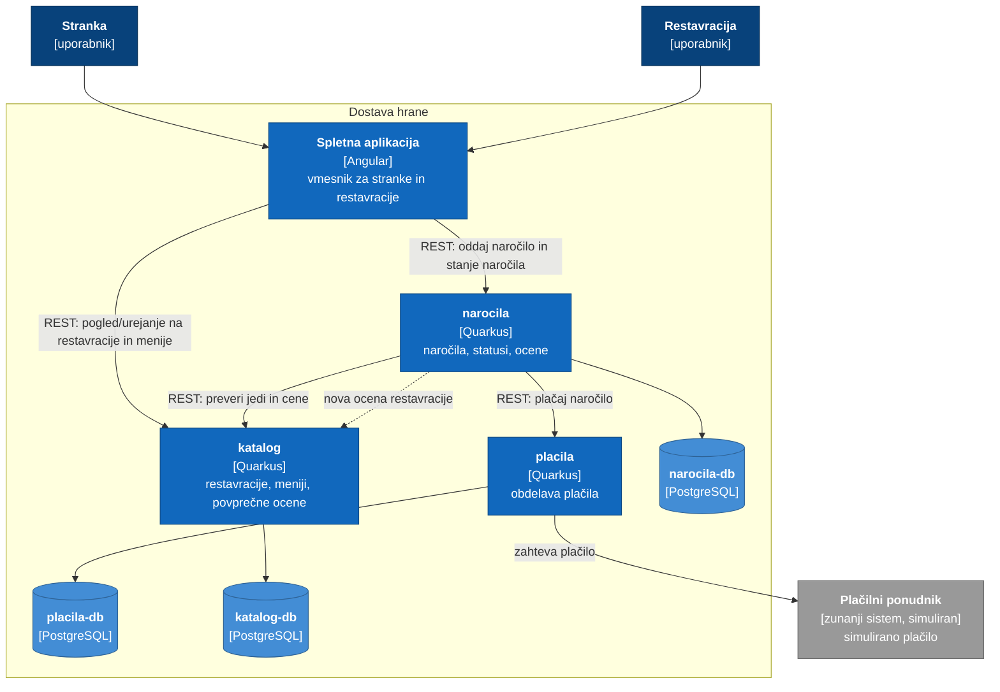

# C4 diagrami nivo 2: storitve

## Legenda

- **temno modro**: uporabniki sistema
- **modro**: naš sistem oziroma njegove storitve
- **sivo**: zunanji sistemi
- **svetlo modro**: baze
- **polna črta**: sinhron klic
- **črtkana črta**: asinhrono sporočilo